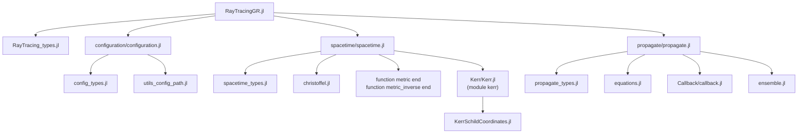
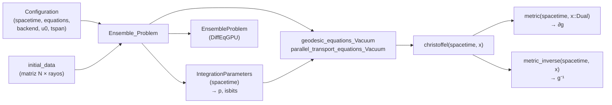

# RayTracingGR.jl

[](https://mabrudsky.github.io/RayTracingGR.jl/stable/)
[](https://mabrudsky.github.io/RayTracingGR.jl/dev/)
[](https://github.com/mabrudsky/RayTracingGR.jl/actions/workflows/CI.yml?query=branch%3Amain)

Trazado de rayos (*ray tracing*) de fotones en Relatividad General, pensado para correr en **GPU**.
Integra las ecuaciones de las geodésicas nulas, y opcionalmente el transporte paralelo de una base de
polarización, sobre un espacio-tiempo curvo. Usa ensembles de
[DiffEqGPU.jl](https://github.com/SciML/DiffEqGPU.jl) para propagar muchos rayos en paralelo.

> **Estado:** en desarrollo (v0.1.0). Hoy se pueden usar la métrica de Kerr en coordenadas de
> Kerr-Schild, su inversa y los símbolos de Christoffel. La propagación de rayos está en construcción
> (ver [Pendientes](#pendientes)).

---

# Principios de diseño

Todo el código que corre dentro de un kernel de GPU sigue estas reglas:

- **isbits**: los structs que viajan a la GPU (espacio-tiempo y parámetros) no contienen punteros ni
  arreglos dinámicos.
- **Cero alocaciones**: se usan `SVector`, `SMatrix` y `SArray` de StaticArrays.jl, y las ecuaciones
  son *out-of-place* (devuelven un `SVector` nuevo).
- **Poca memoria y buen uso de caché**: se evitan arreglos intermedios grandes y se busca reducir el
  uso de registros.
- **Derivadas automáticas compatibles con GPU**: los símbolos de Christoffel se obtienen derivando la
  métrica con números duales de ForwardDiff (`Dual`), que también son isbits.
- **Todo genérico a partir de la métrica**: como `christoffel`, cada magnitud física se escribe como
  una función genérica de `(spacetime, x)` que solo usa `metric`, `metric_inverse` y sus derivadas con
  Duales. Una métrica nueva solo define su struct (con `topology`), `metric` y `metric_inverse`.

---

# Uso rápido

```julia
using RayTracingGR
using StaticArrays

st = kerr.KerrSchildCoordinates(M = 1.0, a = 0.5)   # también: kerr.KerrSchildCoordinates(1.0, 0.5)
x  = SVector(0.0, 3.0, 0.05, 1.0)                   # (t, x, y, z)

g    = metric(st, x)          # g_{μν}    :: SMatrix{4,4}
ginv = metric_inverse(st, x)  # g^{μν}    :: SMatrix{4,4}
Γ    = christoffel(st, x)     # Γ^λ_{μν}  :: SArray{Tuple{4,4,4}}, guardado como Γ[μ, ν, λ]
```

`M` y `a` tienen que ser los dos `Float32` o los dos `Float64`. Además, se exige `M ≥ 0` y `|a| ≤ M`.

## Convenciones

| Elemento | Convención |
|---|---|
| Signatura | $(-,+,+,+)$ |
| Coordenadas de Kerr-Schild | $x^\mu = (t, x, y, z)$ |
| Christoffel | `Γ[μ, ν, λ]` $= \Gamma^{\lambda}{}_{\mu\nu}$ (índice superior en la **última** posición) |
| Estado de una geodésica | $u = (x^\mu, k^\mu)$: 8 componentes |
| Estado con transporte paralelo | $u = (x^\mu, k^\mu, e_x^\mu, e_y^\mu)$: 16 componentes |

**Métrica de Kerr en coordenadas de Kerr-Schild**

$$
g_{\mu\nu} = \eta_{\mu\nu} + 2H\, l_\mu l_\nu,
\qquad
g^{\mu\nu} = \eta^{\mu\nu} - 2H\, l^\mu l^\nu,
\qquad
\eta_{\mu\nu} = \mathrm{diag}(-1, 1, 1, 1)
$$

con

$$
H = \frac{M r^3}{r^4 + a^2 z^2},
\qquad
l_\mu = \left(1,\ \frac{r x + a y}{r^2 + a^2},\ \frac{r y - a x}{r^2 + a^2},\ \frac{z}{r}\right),
\qquad
l^\mu = \eta^{\mu\nu} l_\nu = \left(-1,\ l_x,\ l_y,\ l_z\right)
$$

donde $r$ es el radio de Kerr, definido implícitamente por

$$
r^2 = \frac{1}{2}\left(\rho^2 - a^2\right) + \sqrt{\frac{1}{4}\left(\rho^2 - a^2\right)^2 + a^2 z^2},
\qquad
\rho^2 = x^2 + y^2 + z^2 .
$$

---

# Estructura del proyecto

## Carpetas y archivos

```text
RayTracingGR.jl/
├── Project.toml                      # dependencias y compatibilidad
├── README.md
├── src/
│   ├── RayTracingGR.jl               # módulo principal: imports, includes y exports
│   ├── RayTracing_types.jl           # tipos abstractos raíz de toda la librería
│   │
│   ├── configuration/
│   │   ├── configuration.jl          # punto de entrada (includes)
│   │   ├── config_types.jl           # IntegrationParameters, Configuration
│   │   └── utils_config_path.jl      # (comentado, sin uso)
│   │
│   ├── spacetime/
│   │   ├── spacetime.jl              # punto de entrada; declara metric / metric_inverse
│   │   ├── spacetime_types.jl        # AbstractKerrSpacetime, tipos de coordenadas
│   │   ├── christoffel.jl            # Γ genérico vía ForwardDiff (_christoffel_ForwardDiff)
│   │   └── Kerr/
│   │       ├── Kerr.jl               # submódulo `kerr`
│   │       └── KerrSchildCoordinates.jl  # struct + metric, metric_inverse, christoffel
│   │
│   ├── propagate/
│   │   ├── propagate.jl              # punto de entrada (includes)
│   │   ├── propagate_types.jl        # (vacío)
│   │   ├── equations.jl              # RHS: geodésica y transporte paralelo
│   │   ├── ensemble.jl               # tipos de ecuaciones + Ensemble_Problem
│   │   └── Callback/
│   │       └── callback.jl           # (comentado, a rehacer)
│   │
│   └── Document/Chat_Copilot/analisis_raytracing.md   # notas (a mover a docs/)
│
├── test/
│   ├── runtests.jl
│   └── metric/
│       └── christoffel_tests_KerrSchildCoordinates.jl  # ∇g = 0 + benchmarks
│
├── docs/                             # Documenter.jl
└── dev/
    ├── TAREAS.md                     # lista de tareas (fuente de verdad)
    └── REVISION_2026-11-12.md        # revisión de código con soluciones propuestas
```

## Cómo se cargan los archivos

Todo pertenece al módulo `RayTracingGR`, salvo el submódulo `kerr`. Los archivos se incluyen en este
orden:



`metric`, `metric_inverse` y `christoffel` se declaran **una sola vez** en el módulo principal. Cada
submódulo de espacio-tiempo, como `kerr`, las importa y les **agrega un método** para su propio tipo.
Así, todos los espacio-tiempos comparten las mismas funciones genéricas y el despacho múltiple elige
la implementación correcta.

## Flujo de cálculo de un rayo



## Jerarquía de tipos

```text
AbstractRayTracing
├── AbstractSpacetime
│   └── AbstractKerrSpacetime
│       └── KerrSchildCoordinates{T}          (M, a, topology)
├── AbstractCoordinate                        → valores del campo `topology`
│   ├── CartesianCoordinate
│   └── SphericalCoordinate
├── AbstractConfiguration
│   ├── IntegrationParameters{S}              → viaja a la GPU como `p`
│   └── Configuration{N, T, S, E, B}          → se queda en la CPU
└── AbstractPropagate
    └── AbstractEquationSet                   → el tipo de ecuación define la física (vacío, ...)
        ├── GeodesicEquationsVacuum
        └── ParallelTransportEquationsVacuum

AbstractChristoffel
└── ChristoffelTag                            (tag de ForwardDiff)
```

## Agregar un nuevo espacio-tiempo (patrón actual)

1. Crear `src/spacetime/<Familia>/<Familia>.jl` con un `module`, que importe desde
   `..RayTracingGR` los tipos abstractos y las funciones `metric`, `metric_inverse` y `christoffel`.
2. En un archivo aparte, definir el struct (isbits, parametrizado en `T<:Union{Float32,Float64}`) y
   los métodos `metric(st, x::SVector{4,T})`, `metric_inverse(...)`, `christoffel(...)` y
   `numtype(::MiEspacioTiempo{T}) where {T} = T`. `metric` tiene que aceptar un `T` genérico, porque
   recibe números `Dual`. `Ensemble_Problem` usa `numtype` para comprobar que la precisión coincida
   con la de `u0`.
3. Incluirlo en `src/spacetime/spacetime.jl` y exportarlo desde `src/RayTracingGR.jl`.

---

# Tests

```julia
# desde la carpeta del proyecto
julia --project=. test/runtests.jl
# o bien
julia --project=. -e "using Pkg; Pkg.test()"
```

El test actual verifica que la derivada covariante de la métrica se anule (∇g = 0) en tres puntos.
Con eso comprueba que `metric_inverse` sea la inversa de `metric` y que las convenciones de índices
de `christoffel` sean correctas. También muestra benchmarks: todas las funciones corren sin alocar
memoria.

---

# Pendientes

La lista viva, con fechas e historial, está en [`dev/TAREAS.md`](dev/TAREAS.md). El detalle y el
código propuesto de cada punto están en [`dev/REVISION_2026-11-12.md`](dev/REVISION_2026-11-12.md).
El número `#N` remite a esa revisión.

<details>
<summary><b>Bloque 1: Bugs ✅ completo</b></summary>

**#1. `KerrSchildCoordinates(1.0, 0.5)` siempre daba error**

Causa: antes había solo dos formas de crear el objeto.

| Llamada | Qué hacía |
|---|---|
| `KerrSchildCoordinates(M=1.0, a=0.5)` (con nombres) | ✅ creaba el objeto |
| `KerrSchildCoordinates(M, a)` (sin nombres, con cualquier número) | ❌ mostraba un error |

La segunda estaba pensada para rechazar valores de tipo inválido, por ejemplo `Int`. Pero como era la
única forma sin nombres, también rechazaba `KerrSchildCoordinates(1.0, 0.5)`, que es válida.

Corrección: se agregó la forma sin nombres para `Float32` y `Float64`.

| Llamada | Antes | Ahora |
|---|---|---|
| `KerrSchildCoordinates(M=1.0, a=0.5)` | ✅ | ✅ |
| `KerrSchildCoordinates(1.0, 0.5)` | ❌ error (bug) | ✅ |
| `KerrSchildCoordinates(1, 0.5)` | ❌ error | ❌ error (correcto: `Int` no está permitido) |

| Archivo | Cambio |
|---|---|
| `src/spacetime/Kerr/KerrSchildCoordinates.jl` | Constructores explícitos sin `@with_kw`: posicional, con keywords y error claro para tipos inválidos. Se conserva `topology`. |

**#2. `Configuration` no se podía construir**

| Archivo | Cambio |
|---|---|
| `src/RayTracing_types.jl` | Se eliminó `AbstractPhysicalModel`. |
| `src/configuration/config_types.jl` | Se eliminó el campo `model` de `Configuration` e `IntegrationParameters`. |
| `src/propagate/ensemble.jl` | `IntegrationParameters(spacetime)`. |

La física la define el tipo de ecuación (`GeodesicEquationsVacuum`).

**#3. Un sistema de coordenadas era un subtipo de espacio-tiempo**

| Archivo | Cambio |
|---|---|
| `src/spacetime/spacetime_types.jl` | `AbstractCoordinate <: AbstractRayTracing`. |

El campo `topology` se conserva para futuros sistemas de coordenadas y para los callbacks.

**#4. El largo de `u0` no estaba ligado a la ecuación**

| Archivo | Cambio |
|---|---|
| `src/propagate/equations.jl` | Firmas `SVector{8,T}` (geodésica) y `SVector{16,T}` (transporte paralelo). |
| `src/propagate/ensemble.jl` | `state_length(eq)` y chequeo en `Ensemble_Problem`. |

**#5. Mezcla silenciosa de Float32 y Float64**

| Archivo | Cambio |
|---|---|
| `src/spacetime/spacetime.jl` | Declaración `function numtype end`. |
| `src/spacetime/Kerr/Kerr.jl` | `numtype` agregado al `import`. |
| `src/spacetime/Kerr/KerrSchildCoordinates.jl` | `numtype(::KerrSchildCoordinates{T}) = T`. |
| `src/propagate/ensemble.jl` | Chequeo de precisión en `Ensemble_Problem`. |

**Qué detecta ahora `Ensemble_Problem` antes de integrar**

| Error de configuración | Mensaje |
|---|---|
| Largo de `u0` distinto al de la ecuación | `DimensionMismatch: ParallelTransportEquationsVacuum needs u0 of length 16, got 8` |
| Precisión distinta entre el espacio-tiempo y `u0` | `ArgumentError: spacetime uses Float64 but u0 uses Float32; use the same precision ...` |
| Filas de `initial_data` ≠ largo de `u0` | `DimensionMismatch` (ya existía) |

</details>

<details>
<summary><b>Bloque 2: Dependencias ✅ completo</b></summary>

**#12. `DifferentialEquations` → `SciMLBase`**

La librería solo usa `ODEProblem`, `EnsembleProblem` y `remake`, que están en `SciMLBase`.
`DifferentialEquations` instalaba además todos los solvers de CPU (`OrdinaryDiffEq` y otros), que no se
usan: los solvers de GPU vienen en `DiffEqGPU`.

| Archivo | Cambio |
|---|---|
| `Project.toml` | `SciMLBase` (compat `3.50`) en lugar de `DifferentialEquations`. |
| `src/RayTracingGR.jl` | `import DifferentialEquations as DE` → `import SciMLBase`. |
| `src/propagate/ensemble.jl` | `DE.ODEProblem`, `DE.remake`, `DE.EnsembleProblem` → `SciMLBase.…` |

**#13. `BenchmarkTools` solo en tests**

| Archivo | Cambio |
|---|---|
| `Project.toml` | `BenchmarkTools` pasa de `[deps]` a `[extras]`; `[targets] test = ["Test", "BenchmarkTools"]`. |

Los tests ahora se corren con `Pkg.test()`:

| Comando | Antes | Ahora |
|---|---|---|
| `julia --project=. -e 'using Pkg; Pkg.test()'` | ✅ | ✅ |
| `julia --project=. test/runtests.jl` | ✅ | ❌ no encuentra `BenchmarkTools` |

**#14. Quitar `Parameters` y `import KernelAbstractions as KA`**

| Archivo | Cambio |
|---|---|
| `Project.toml` | Se quitó `Parameters`. |
| `src/RayTracingGR.jl` | Sin `import Parameters: @with_kw`; `using KernelAbstractions` → `import KernelAbstractions as KA`. |
| `src/spacetime/Kerr/Kerr.jl` | Se borró `using Parameters` (sin uso desde el #1). |
| `src/configuration/config_types.jl` | `@with_kw` → `Base.@kwdef`; `B <: KA.Backend`. |
| `src/propagate/ensemble.jl` | `B <: KA.Backend` en las tres firmas. |

`using KernelAbstractions` traía todos los nombres del paquete (`CPU`, `@kernel`, `synchronize`, ...)
dentro de la librería, aunque solo se usa el tipo `Backend`. Con `import ... as KA` no se trae ningún
nombre suelto y se escribe `KA.Backend`, que es el mismo tipo. El backend se sigue eligiendo igual
desde el script del usuario:

```julia
using RayTracingGR
using KernelAbstractions   # CPU()   — o: using CUDA → CUDABackend()

cfg = RayTracingGR.Configuration(spacetime = st, equations = RayTracingGR.GeodesicEquationsVacuum(),
                                 backend = CPU(), u0 = u0, tspan = (0.0, 1.0))
```

Único cambio visible: si falta un campo al construir `Configuration`, el error ahora es
`UndefKeywordError: keyword argument 'u0' not assigned`.

</details>

<details>
<summary><b>Bloque 3: Estructura</b></summary>

- [ ] #9 Unificar los dos `_Ensemble_Problem` con una función `rhs(...)`; mover los tipos de
  ecuaciones a `propagate_types.jl`.
- [ ] #10 Renombrar el submódulo `kerr` → `Kerr`, exportar `KerrSchildCoordinates` y limpiar
  imports y exports redundantes.
- [ ] #11 Fallbacks genéricos de `christoffel` y `metric_inverse`; eliminar `AbstractChristoffel`.

</details>

<details>
<summary><b>Bloque 4: GPU</b></summary>

- [ ] #6 Contraer Γ^λ_{μν}u^μv^ν directamente, sin construir el Γ completo (menos registros y
  operaciones).
- [ ] #7 `ntuple(f, 4)` → `ntuple(f, Val(4))`.
- [ ] #8 Resolver con `save_everystep=false, save_start=false`; `initial_data` tiene que ser una
  `Matrix` de CPU.

</details>

<details>
<summary><b>Bloque 5: Tests y orden</b></summary>

- [ ] #15 Mover los benchmarks a `benchmark/`; tests de isbits, `@allocated == 0` y Float32.
- [ ] #16 Callback de terminación (horizonte / radio máximo); mover `src/Document` a `docs/`; sacar
  `utils_config_path.jl`; renombrar `k` → `st` en `_christoffel_ForwardDiff`.

</details>

<details>
<summary><b>Bloque 6: Tests de validación (diferenciación automática de Christoffel y métricas)</b></summary>

El test actual (∇g = 0) comprueba que `metric_inverse` sea la inversa de `metric` y las convenciones
de índices. Pero ∇g = 0 se cumple para cualquier métrica simétrica, así que no alcanza para validar la
diferenciación automática ni la física. Estos tests completan esa validación:

- [ ] #17 **Diferenciación automática vs diferencias finitas**: comparar `christoffel` con Γ calculado
  por diferencias finitas centradas. Es una prueba independiente de ForwardDiff.
- [ ] #18 **Vector nulo**: η l l = 0, g⁻¹ l l = 0 y g lᵘ lᵛ = 0. Valida `_H_l`.
- [ ] #19 **Límite a = 0**: la métrica tiene que coincidir con Schwarzschild en Kerr-Schild.
- [ ] #20 **Ricci = 0**: confirma que la métrica es solución de vacío. Además prueba la diferenciación
  automática de segundo orden.
- [ ] #21 **Constantes de movimiento** a lo largo de una geodésica (condición nula, E, L_z, Carter).
  Depende de que la propagación funcione.

</details>

<details>
<summary><b>Propuestas en evaluación (no confirmadas)</b></summary>

- `Configuration`: `tspan::Tuple{T,T}` no convierte tipos; `(0.0, 100)` da un `MethodError`. Hay que
  decidir entre documentarlo o agregar una conversión.

</details>
