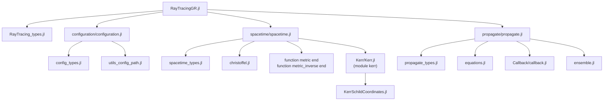
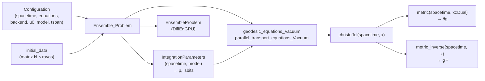

# RayTracingGR.jl

[](https://mabrudsky.github.io/RayTracing.jl/stable/)
[](https://mabrudsky.github.io/RayTracing.jl/dev/)
[](https://github.com/mabrudsky/RayTracing.jl/actions/workflows/CI.yml?query=branch%3Amain)

Trazado de rayos (*ray tracing*) de fotones en Relatividad General, pensado para correr en **GPU**.
Integra las ecuaciones de las geodésicas nulas, y opcionalmente el transporte paralelo de una base de
polarización, sobre un espacio-tiempo curvo. Usa ensembles de
[DiffEqGPU.jl](https://github.com/SciML/DiffEqGPU.jl) para propagar muchos rayos en paralelo.

> **Estado:** en desarrollo (v0.1.0). Hoy se pueden usar la métrica de Kerr en coordenadas de
> Kerr-Schild, su inversa y los símbolos de Christoffel. La propagación de rayos está en construcción
> (ver [Pendientes](#pendientes)).

---

## Principios de diseño

Todo el código que corre dentro de un kernel de GPU sigue estas reglas:

- **isbits**: los structs que viajan a la GPU (espacio-tiempo y parámetros) no contienen punteros ni
  arreglos dinámicos.
- **Cero alocaciones**: se usan `SVector`, `SMatrix` y `SArray` de StaticArrays.jl, y las ecuaciones
  son *out-of-place* (devuelven un `SVector` nuevo).
- **Poca memoria y buen uso de caché**: se evitan arreglos intermedios grandes y se busca reducir el
  uso de registros.
- **Derivadas automáticas compatibles con GPU**: los símbolos de Christoffel se obtienen derivando la
  métrica con números duales de ForwardDiff (`Dual`), que también son isbits.

---

## Uso rápido

```julia
using RayTracingGR
using StaticArrays

st = kerr.KerrSchildCoordinates(M = 1.0, a = 0.5)   # también: kerr.KerrSchildCoordinates(1.0, 0.5)
x  = SVector(0.0, 3.0, 0.05, 1.0)                   # (t, x, y, z)

g    = metric(st, x)          # g_{μν}    :: SMatrix{4,4}
ginv = metric_inverse(st, x)  # g^{μν}    :: SMatrix{4,4}
Γ    = christoffel(st, x)     # Γ^λ_{μν}  :: SArray{Tuple{4,4,4}}, guardado como Γ[μ, ν, λ]
```

`M` y `a` tienen que ser los dos `Float32` o los dos `Float64`. Además, se exige `M ≥ 0` y `|a| ≤ M`.

### Convenciones

| Elemento | Convención |
|---|---|
| Signatura | (−, +, +, +) |
| Coordenadas de Kerr-Schild | `x = (t, x, y, z)` |
| Métrica | g_{μν} = η_{μν} + 2H l_μ l_ν, con l_μ = (1, l_x, l_y, l_z) |
| Christoffel | `Γ[μ, ν, λ] = Γ^λ_{μν}` (índice superior en la **última** posición) |
| Estado de una geodésica | `u = (x⁰..x³, k⁰..k³)`: 8 componentes |
| Estado con transporte paralelo | `u = (x, k, eₓ, e_y)`: 16 componentes |

---

## Estructura del proyecto

### Carpetas y archivos

```text
RayTracingGR.jl/
├── Project.toml                      # dependencias y compatibilidad
├── README.md
├── src/
│   ├── RayTracingGR.jl               # módulo principal: imports, includes y exports
│   ├── RayTracing_types.jl           # tipos abstractos raíz de toda la librería
│   │
│   ├── configuration/
│   │   ├── configuration.jl          # punto de entrada (includes)
│   │   ├── config_types.jl           # IntegrationParameters, Configuration
│   │   └── utils_config_path.jl      # (comentado, sin uso)
│   │
│   ├── spacetime/
│   │   ├── spacetime.jl              # punto de entrada; declara metric / metric_inverse
│   │   ├── spacetime_types.jl        # AbstractKerrSpacetime, tipos de coordenadas
│   │   ├── christoffel.jl            # Γ genérico vía ForwardDiff (_christoffel_ForwardDiff)
│   │   └── Kerr/
│   │       ├── Kerr.jl               # submódulo `kerr`
│   │       └── KerrSchildCoordinates.jl  # struct + metric, metric_inverse, christoffel
│   │
│   ├── propagate/
│   │   ├── propagate.jl              # punto de entrada (includes)
│   │   ├── propagate_types.jl        # (vacío)
│   │   ├── equations.jl              # RHS: geodésica y transporte paralelo
│   │   ├── ensemble.jl               # tipos de ecuaciones + Ensemble_Problem
│   │   └── Callback/
│   │       └── callback.jl           # (comentado, a rehacer)
│   │
│   └── Document/Chat_Copilot/analisis_raytracing.md   # notas (a mover a docs/)
│
├── test/
│   ├── runtests.jl
│   └── metric/
│       └── christoffel_tests_KerrSchildCoordinates.jl  # ∇g = 0 + benchmarks
│
├── docs/                             # Documenter.jl
└── dev/
    ├── TAREAS.md                     # lista de tareas (fuente de verdad)
    └── REVISION_2026-11-12.md        # revisión de código con soluciones propuestas
```

### Cómo se cargan los archivos

Todo pertenece al módulo `RayTracingGR`, salvo el submódulo `kerr`. Los archivos se incluyen en este
orden:



`metric`, `metric_inverse` y `christoffel` se declaran **una sola vez** en el módulo principal. Cada
submódulo de espacio-tiempo, como `kerr`, las importa y les **agrega un método** para su propio tipo.
Así, todos los espacio-tiempos comparten las mismas funciones genéricas y el despacho múltiple elige
la implementación correcta.

### Flujo de cálculo de un rayo



### Jerarquía de tipos

```text
AbstractRayTracing
├── AbstractSpacetime
│   ├── AbstractKerrSpacetime
│   │   └── KerrSchildCoordinates{T}          (M, a, topology)
│   └── AbstractCoordinate                    ⚠ debería colgar de AbstractRayTracing (#3)
│       ├── CartesianCoordinate
│       └── SphericalCoordinate
├── AbstractConfiguration
│   ├── IntegrationParameters{S, M}           → viaja a la GPU como `p`
│   └── Configuration{N, T, S, E, B, M}       → se queda en la CPU
├── AbstractPropagate
│   └── AbstractEquationSet
│       ├── GeodesicEquationsVacuum
│       └── ParallelTransportEquationsVacuum
└── AbstractPhysicalModel                     ⚠ todavía sin subtipos concretos (#2)

AbstractChristoffel
└── ChristoffelTag                            (tag de ForwardDiff)
```

### Agregar un nuevo espacio-tiempo (patrón actual)

1. Crear `src/spacetime/<Familia>/<Familia>.jl` con un `module`, que importe desde
   `..RayTracingGR` los tipos abstractos y las funciones `metric`, `metric_inverse` y `christoffel`.
2. En un archivo aparte, definir el struct (isbits, parametrizado en `T<:Union{Float32,Float64}`) y
   los métodos `metric(st, x::SVector{4,T})`, `metric_inverse(...)` y `christoffel(...)`.
   `metric` tiene que aceptar un `T` genérico, porque recibe números `Dual`.
3. Incluirlo en `src/spacetime/spacetime.jl` y exportarlo desde `src/RayTracingGR.jl`.

---

## Tests

```julia
# desde la carpeta del proyecto
julia --project=. test/runtests.jl
# o bien
julia --project=. -e "using Pkg; Pkg.test()"
```

El test actual verifica que la derivada covariante de la métrica se anule (∇g = 0) en tres puntos.
Con eso comprueba que `metric_inverse` sea la inversa de `metric` y que las convenciones de índices
de `christoffel` sean correctas. También muestra benchmarks: todas las funciones corren sin alocar
memoria.

---

## Pendientes

La lista viva, con fechas e historial, está en [`dev/TAREAS.md`](dev/TAREAS.md). El detalle y el
código propuesto de cada punto están en [`dev/REVISION_2026-11-12.md`](dev/REVISION_2026-11-12.md).
El número `#N` remite a esa revisión.

### Bloque 1: Bugs
- [x] #1 Constructor posicional `KerrSchildCoordinates(1.0, 0.5)`: corregido sin `@with_kw`.
- [ ] #2 Crear un modelo físico concreto: `struct Vacuum <: AbstractPhysicalModel end`. Sin él,
  `Configuration` no se puede construir.
- [ ] #3 `AbstractCoordinate` tiene que colgar de `AbstractRayTracing`, no de `AbstractSpacetime`.
  Además, conviene reemplazar el campo `topology` por un *trait* `coordinates(...)`.
- [ ] #4 Ligar la dimensión `N` a la ecuación (`SVector{8}` / `SVector{16}` + `state_length`). Hoy
  `@inbounds` puede leer fuera de rango sin avisar.
- [ ] #5 Evitar la mezcla silenciosa de precisión entre el espacio-tiempo y `u0` (`numtype` + chequeo).

### Bloque 2: Dependencias
- [ ] #12 Reemplazar `DifferentialEquations` por `SciMLBase` (compat `3.50`). Compila mucho menos.
- [ ] #13 Mover `BenchmarkTools` a las dependencias de test.
- [ ] #14 Quitar `Parameters` (pasar a `Base.@kwdef`); `import KernelAbstractions as KA`.

### Bloque 3: Estructura
- [ ] #9 Unificar los dos `_Ensemble_Problem` con una función `rhs(...)`; mover los tipos de
  ecuaciones a `propagate_types.jl`.
- [ ] #10 Renombrar el submódulo `kerr` → `Kerr`, exportar `KerrSchildCoordinates` y limpiar
  imports y exports redundantes.
- [ ] #11 Fallbacks genéricos de `christoffel` y `metric_inverse`; eliminar `AbstractChristoffel`.

### Bloque 4: GPU
- [ ] #6 Contraer Γ^λ_{μν}u^μv^ν directamente, sin construir el Γ completo (menos registros y
  operaciones).
- [ ] #7 `ntuple(f, 4)` → `ntuple(f, Val(4))`.
- [ ] #8 Resolver con `save_everystep=false, save_start=false`; `initial_data` tiene que ser una
  `Matrix` de CPU.

### Bloque 5: Tests y orden
- [ ] #15 Mover los benchmarks a `benchmark/`; tests de isbits, `@allocated == 0` y Float32.
- [ ] #16 Callback de terminación (horizonte / radio máximo); mover `src/Document` a `docs/`; sacar
  `utils_config_path.jl`; renombrar `k` → `st` en `_christoffel_ForwardDiff`.

### Bloque 6: Tests de validación (diferenciación automática de Christoffel y métricas)
El test actual (∇g = 0) comprueba que `metric_inverse` sea la inversa de `metric` y las convenciones
de índices. Pero ∇g = 0 se cumple para cualquier métrica simétrica, así que no alcanza para validar la
diferenciación automática ni la física. Estos tests completan esa validación:

- [ ] #17 **Diferenciación automática vs diferencias finitas**: comparar `christoffel` con Γ calculado
  por diferencias finitas centradas. Es una prueba independiente de ForwardDiff.
- [ ] #18 **Vector nulo**: η l l = 0, g⁻¹ l l = 0 y g lᵘ lᵛ = 0. Valida `_H_l`.
- [ ] #19 **Límite a = 0**: la métrica tiene que coincidir con Schwarzschild en Kerr-Schild.
- [ ] #20 **Ricci = 0**: confirma que la métrica es solución de vacío. Además prueba la diferenciación
  automática de segundo orden.
- [ ] #21 **Constantes de movimiento** a lo largo de una geodésica (condición nula, E, L_z, Carter).
  Depende de #2 y de la propagación.

### Propuestas en evaluación (no confirmadas)
- `Configuration`: `tspan::Tuple{T,T}` no convierte tipos; `(0.0, 100)` da un `MethodError`. Hay que
  decidir entre documentarlo o agregar una conversión.
