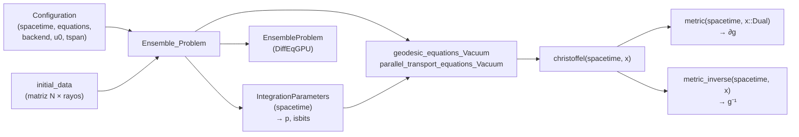

# RayTracingGR.jl

[](https://mabrudsky.github.io/RayTracingGR.jl/stable/)
[](https://mabrudsky.github.io/RayTracingGR.jl/dev/)
[](https://github.com/mabrudsky/RayTracingGR.jl/actions/workflows/CI.yml?query=branch%3Amain)

Trazado de rayos (*ray tracing*) de fotones en Relatividad General, pensado para correr en **GPU**.
Integra las ecuaciones de las geodésicas nulas, y opcionalmente el transporte paralelo de una base de
polarización, sobre un espacio-tiempo curvo. Usa ensembles de
[DiffEqGPU.jl](https://github.com/SciML/DiffEqGPU.jl) para propagar muchos rayos en paralelo.

> **Estado:** en desarrollo (v0.1.0). Hoy se pueden usar la métrica de Kerr en coordenadas de
> Kerr-Schild, su inversa y los símbolos de Christoffel. La propagación de rayos está en construcción.

---

# Instalación

```julia
using Pkg
Pkg.add(url = "https://github.com/mabrudsky/RayTracingGR.jl")
```

Requiere Julia 1.10 o posterior. Para correr en GPU hay que instalar además el paquete de la placa:
[CUDA.jl](https://github.com/JuliaGPU/CUDA.jl) (NVIDIA), [AMDGPU.jl](https://github.com/JuliaGPU/AMDGPU.jl),
[Metal.jl](https://github.com/JuliaGPU/Metal.jl) (Apple) u [oneAPI.jl](https://github.com/JuliaGPU/oneAPI.jl) (Intel).

---

# Uso rápido

```julia
using RayTracingGR
using StaticArrays

st = Kerr.KerrSchildCoordinates(M = 1.0, a = 0.5)   # también: Kerr.KerrSchildCoordinates(1.0, 0.5)
x  = SVector(0.0, 3.0, 0.05, 1.0)                   # (t, x, y, z)

g    = metric(st, x)          # g_{μν}    :: SMatrix{4,4}
ginv = metric_inverse(st, x)  # g^{μν}    :: SMatrix{4,4}
Γ    = christoffel(st, x)     # Γ^λ_{μν}  :: SArray{Tuple{4,4,4}}, guardado como Γ[μ, ν, λ]
```

`M` y `a` tienen que ser los dos `Float32` o los dos `Float64`. Además, se exige `M ≥ 0` y `|a| ≤ M`.

## Convenciones

| Elemento | Convención |
|---|---|
| Signatura | $(-,+,+,+)$ |
| Coordenadas de Kerr-Schild | $x^\mu = (t, x, y, z)$ |
| Christoffel | `Γ[μ, ν, λ]` $= \Gamma^{\lambda}{}_{\mu\nu}$ (índice superior en la **última** posición) |
| Estado de una geodésica | $u = (x^\mu, k^\mu)$: 8 componentes |
| Estado con transporte paralelo | $u = (x^\mu, k^\mu, e_x^\mu, e_y^\mu)$: 16 componentes |

**Métrica de Kerr en coordenadas de Kerr-Schild**

$$
g_{\mu\nu} = \eta_{\mu\nu} + 2H\, l_\mu l_\nu,
\qquad
g^{\mu\nu} = \eta^{\mu\nu} - 2H\, l^\mu l^\nu,
\qquad
\eta_{\mu\nu} = \mathrm{diag}(-1, 1, 1, 1)
$$

con

$$
H = \frac{M r^3}{r^4 + a^2 z^2},
\qquad
l_\mu = \left(1,\ \frac{r x + a y}{r^2 + a^2},\ \frac{r y - a x}{r^2 + a^2},\ \frac{z}{r}\right),
\qquad
l^\mu = \eta^{\mu\nu} l_\nu = \left(-1,\ l_x,\ l_y,\ l_z\right)
$$

donde $r$ es el radio de Kerr, definido implícitamente por

$$
r^2 = \frac{1}{2}\left(\rho^2 - a^2\right) + \sqrt{\frac{1}{4}\left(\rho^2 - a^2\right)^2 + a^2 z^2},
\qquad
\rho^2 = x^2 + y^2 + z^2 .
$$

---

# Principios de diseño

Todo el código que corre dentro de un kernel de GPU sigue estas reglas:

- **isbits**: los structs que viajan a la GPU (espacio-tiempo y parámetros) no contienen punteros ni
  arreglos dinámicos.
- **Cero alocaciones**: se usan `SVector`, `SMatrix` y `SArray` de StaticArrays.jl, y las ecuaciones
  son *out-of-place* (devuelven un `SVector` nuevo).
- **Poca memoria y buen uso de caché**: se evitan arreglos intermedios grandes y se busca reducir el
  uso de registros.
- **Derivadas automáticas compatibles con GPU**: los símbolos de Christoffel se obtienen derivando la
  métrica con números duales de ForwardDiff (`Dual`), que también son isbits.
- **Todo genérico a partir de la métrica**: como `christoffel`, cada magnitud física se escribe como
  una función genérica de `(spacetime, x)` que solo usa `metric`, `metric_inverse` y sus derivadas con
  Duales. Una métrica nueva solo define su struct (con `topology`), `metric` y `metric_inverse`.

---

# Estructura del proyecto

## Carpetas y archivos

```text
RayTracingGR.jl/
├── Project.toml                      # dependencias y compatibilidad
├── README.md                         # para usuarios
├── CONTRIBUTING.md                   # guía para colaboradores
├── src/
│   ├── RayTracingGR.jl               # módulo principal: imports, includes y exports
│   ├── RayTracing_types.jl           # tipos abstractos raíz de toda la librería
│   │
│   ├── configuration/
│   │   ├── configuration.jl          # punto de entrada (includes)
│   │   ├── config_types.jl           # IntegrationParameters, Configuration
│   │   └── utils_config_path.jl      # (comentado, sin uso)
│   │
│   ├── spacetime/
│   │   ├── spacetime.jl              # punto de entrada; declara metric / metric_inverse
│   │   ├── spacetime_types.jl        # AbstractKerrSpacetime, tipos de coordenadas
│   │   ├── christoffel.jl            # christoffel genérico (fallback) vía ForwardDiff
│   │   └── Kerr/
│   │       ├── Kerr.jl               # submódulo `Kerr`
│   │       └── KerrSchildCoordinates.jl  # struct + metric, metric_inverse, numtype
│   │
│   ├── propagate/
│   │   ├── propagate.jl              # punto de entrada (includes)
│   │   ├── propagate_types.jl        # subtipos abstractos de propagación (hoy vacío)
│   │   ├── equations.jl              # RHS: geodésica y transporte paralelo
│   │   ├── ensemble.jl               # tipos de ecuaciones, rhs + Ensemble_Problem
│   │   └── Callback/
│   │       └── callback.jl           # (comentado, a rehacer)
│   │
│   └── Document/Chat_Copilot/analisis_raytracing.md   # notas (a mover a docs/)
│
├── test/
│   ├── runtests.jl
│   └── metric/
│       └── christoffel_tests_KerrSchildCoordinates.jl  # ∇g = 0 + benchmarks
│
├── docs/                             # Documenter.jl
└── dev/
    ├── TAREAS.md                     # lista de tareas (fuente de verdad)
    └── REVISION_2026-11-12.md        # revisión de código con soluciones propuestas
```

## Cómo se cargan los archivos

Todo pertenece al módulo `RayTracingGR`, salvo el submódulo `Kerr`. Los archivos se incluyen en este
orden:


`metric`, `metric_inverse` y `christoffel` se declaran **una sola vez** en el módulo principal. Cada
submódulo de espacio-tiempo, como `Kerr`, importa `metric` y `metric_inverse` y les **agrega un método**
para su propio tipo. `christoffel` tiene un método genérico (fallback) que sirve para cualquier
espacio-tiempo: deriva `metric` con números duales. Así, todos los espacio-tiempos comparten las mismas
funciones y el despacho múltiple elige la implementación correcta.

## Flujo de cálculo de un rayo



## Jerarquía de tipos

```text
AbstractRayTracing
├── AbstractSpacetime
│   └── AbstractKerrSpacetime
│       └── KerrSchildCoordinates{T}          (M, a, topology)
├── AbstractCoordinate                        → valores del campo `topology`
│   ├── CartesianCoordinate
│   └── SphericalCoordinate
├── AbstractConfiguration
│   ├── IntegrationParameters{S}              → viaja a la GPU como `p`
│   └── Configuration{N, T, S, E, B}          → se queda en la CPU
└── AbstractPropagate
    └── AbstractEquationSet                   → el tipo de ecuación define la física (vacío, ...)
        ├── GeodesicEquationsVacuum
        └── ParallelTransportEquationsVacuum

ChristoffelTag                                (tag de ForwardDiff, fuera de la jerarquía)
```

---

# Contribuir

Cómo agregar un espacio-tiempo nuevo y cómo correr los tests está en
[`CONTRIBUTING.md`](CONTRIBUTING.md).

---

<!-- Oculto por ahora (pendiente: revisar CITATION.bib antes de mostrarlo).
# Cómo citar

Si usás RayTracingGR.jl en un trabajo, podés citarla con [`CITATION.bib`](CITATION.bib).

---
-->

# Licencia

MIT. Ver [`LICENSE`](LICENSE).
