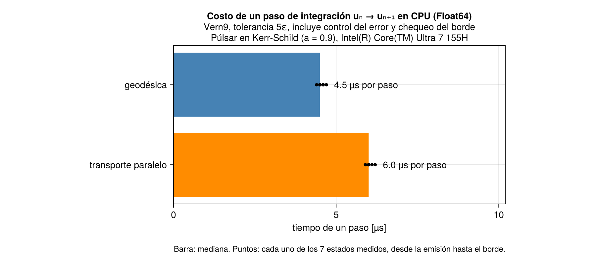
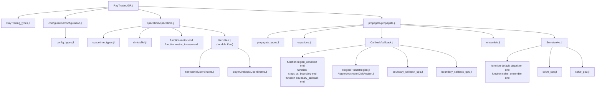
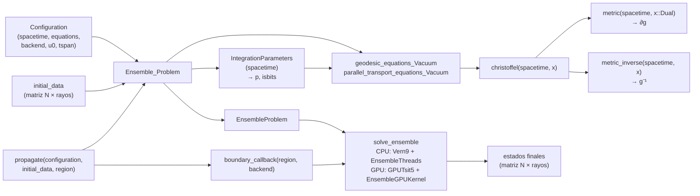

# RayTracingGR.jl

[](https://mabrudsky.github.io/RayTracingGR.jl/stable/)
[](https://mabrudsky.github.io/RayTracingGR.jl/dev/)
[](https://github.com/mabrudsky/RayTracingGR.jl/actions/workflows/CI.yml?query=branch%3Amain)

Trazado de rayos (*ray tracing*) de fotones en Relatividad General, pensado para correr en **GPU**.
Integra las ecuaciones de las geodésicas nulas, y opcionalmente el transporte paralelo de una base de
polarización, sobre un espacio-tiempo curvo. Usa ensembles de
[DiffEqGPU.jl](https://github.com/SciML/DiffEqGPU.jl) para propagar muchos rayos en paralelo.

> **Estado:** en desarrollo (v0.1.0). Hoy se pueden usar la métrica de Kerr en coordenadas de
> Kerr-Schild y de Boyer-Lindquist, su inversa y los símbolos de Christoffel. La propagación de rayos
> está en construcción.

---

# Instalación

```julia
using Pkg
Pkg.add(url = "https://github.com/mabrudsky/RayTracingGR.jl")
```

Requiere Julia 1.10 o posterior. Para correr en GPU hay que instalar además el paquete de la placa:
[CUDA.jl](https://github.com/JuliaGPU/CUDA.jl) (NVIDIA), [AMDGPU.jl](https://github.com/JuliaGPU/AMDGPU.jl),
[Metal.jl](https://github.com/JuliaGPU/Metal.jl) (Apple) u [oneAPI.jl](https://github.com/JuliaGPU/oneAPI.jl) (Intel).

---

# Uso rápido

```julia
using RayTracingGR
using StaticArrays

st = Kerr.KerrSchildCoordinates(M = 1.0, a = 0.5)   # también: Kerr.KerrSchildCoordinates(1.0, 0.5)
x  = SVector(0.0, 3.0, 0.05, 1.0)                   # (t, x, y, z)

g    = metric(st, x)          # g_{μν}    :: SMatrix{4,4}
ginv = metric_inverse(st, x)  # g^{μν}    :: SMatrix{4,4}
Γ    = christoffel(st, x)     # Γ^λ_{μν}  :: SArray{Tuple{4,4,4}}, guardado como Γ[μ, ν, λ]

bl = Kerr.BoyerLindquistCoordinates(M = 1.0, a = 0.5)  # también: Kerr.BoyerLindquistCoordinates(1.0, 0.5)
q  = SVector(0.0, 3.0, 1.0, 0.5)                       # (t, r, θ, φ)
g  = metric(bl, q)                                     # mismas funciones para cualquier espacio-tiempo
```

`M` y `a` tienen que ser los dos `Float32` o los dos `Float64`. Además, se exige `M ≥ 0` y `|a| ≤ M`.

Propagar rayos (cada columna de `initial_data` es un rayo, `(t, x, y, z, kᵗ, kˣ, kʸ, kᶻ)`):

```julia
using RayTracingGR, StaticArrays, KernelAbstractions
using OrdinaryDiffEqTsit5   # solo para el segundo ejemplo (alg = Tsit5())

st     = Kerr.KerrSchildCoordinates(M = 1.0, a = 0.1)
config = Configuration(spacetime = st,
                       equations = GeodesicEquationsVacuum(),
                       backend   = CPU(),
                       u0        = SVector{8}(initial_data[:, 1]),
                       tspan     = (0.0, 500.0))
region = PulsarRegion(R_in = 5.0, R_out = 50.0)

# Matriz 8 × rayos con los estados finales (una columna por rayo)
final = propagate(configuration = config,
                  initial_data  = initial_data,
                  region        = region)

# Cambiar el algoritmo o las opciones de solve
final = propagate(configuration = config,
                  initial_data  = initial_data,
                  region        = region,
                  alg           = Tsit5(),
                  reltol        = 1e-10)

# También sin nombres: propagate(config, initial_data, region; alg = Tsit5())
```

- `backend = CPU()` (Float64): `Vern9()` por defecto. GPU (`CUDABackend()`, ..., Float32): `GPUTsit5()` por defecto.
- Tolerancias por defecto: `abstol = reltol = 5 eps(T)`. Más detalle en
  [`dev/PROPAGATE_2026-11-19.md`](dev/PROPAGATE_2026-11-19.md).

## Regiones: dónde se corta cada rayo

La región (`region`) dice dónde se detiene cada rayo. Hay dos:

| Región | El rayo se detiene | Ejemplo |
|---|---|---|
| `PulsarRegion(R_in, R_out)` | en $r = R_{\text{in}}$ (pega en la estrella) o en $r = R_{\text{out}}$ (escapa) | `PulsarRegion(R_in = 5.0, R_out = 50.0)` |
| `AccretionDiskRegion(R_min, R_max, R_in, R_out)` | al cruzar el plano ecuatorial **dentro** del disco ($R_{\text{in}} \le r \le R_{\text{out}}$), en $r = R_{\min}$ (cae al agujero negro) o en $r = R_{\max}$ (escapa). Si cruza el plano **afuera** del disco, sigue. | `AccretionDiskRegion(R_min = 1.85, R_max = 6000.0, R_in = 1.85, R_out = 15.0)` |

$r$ es el radio de cada sistema de coordenadas (`coordinate_radius`) y $z = r\cos\theta$ la altura sobre el
plano ecuatorial (`coordinate_z`); las dos regiones funcionan en Kerr-Schild y en Boyer-Lindquist.
$R_{\min}$ lo elige el usuario (por ejemplo $r_+ + 0.05$, como en Skylight): la librería no calcula el
horizonte, porque no es una cantidad local.

**Cómo funciona.** Cada región define dos funciones:

1. `region_condition(region, spacetime, x)`: una función $c(x)$ que **cambia de signo** en cada superficie
   donde el rayo puede detenerse. Para el púlsar $c = (r - R_{\text{in}})(R_{\text{out}} - r)$; para el disco

   $$
   c = (r - R_{\min})\,(R_{\max} - r)\; z ,
   $$

   que cambia de signo en $r = R_{\min}$, en $r = R_{\max}$ y en el plano $z = 0$.
2. `stops_at_boundary(region, spacetime, x)`: en el punto donde $c$ cambió de signo, decide si el rayo se
   detiene. Por defecto siempre (púlsar). Para el disco, en el plano solo si $R_{\text{in}} \le r \le R_{\text{out}}$.

El callback que arma `propagate` usa esas dos funciones, igual en CPU y en GPU:

| | CPU (`ContinuousCallback`) | GPU (`DiscreteCallback`, todo `@inline` e isbits) |
|---|---|---|
| Detecta el cruce | el `ContinuousCallback` busca la raíz de $c$ | $c$ cambió de signo entre el paso anterior y el actual |
| Ubica el cruce | búsqueda de raíz del `ContinuousCallback` | bisección sobre la interpolación del paso |
| Si `stops_at_boundary` es verdadero | detiene el rayo en el cruce | lleva el estado al cruce, un paso de Newton lo deja sobre $c = 0$ y detiene el rayo |
| Si es falso | el rayo sigue | no toca el integrador: el rayo sigue |

Para agregar una región nueva: un archivo en `src/propagate/Callback/Region/` con el `struct` (isbits), su
`region_condition` y, si algún cruce no debe detener el rayo, su `stops_at_boundary`.

## Convenciones

| Elemento | Convención |
|---|---|
| Signatura | $(-,+,+,+)$ |
| Coordenadas de Kerr-Schild | $x^\mu = (t, x, y, z)$ |
| Coordenadas de Boyer-Lindquist | $x^\mu = (t, r, \theta, \phi)$ |
| Christoffel | `Γ[μ, ν, λ]` $= \Gamma^{\lambda}{}_{\mu\nu}$ (índice superior en la **última** posición) |
| Estado de una geodésica | $u = (x^\mu, k^\mu)$: 8 componentes |
| Estado con transporte paralelo | $u = (x^\mu, k^\mu, e_x^\mu, e_y^\mu)$: 16 componentes |

**Métrica de Kerr en coordenadas de Kerr-Schild**

$$
g_{\mu\nu} = \eta_{\mu\nu} + 2H\, l_\mu l_\nu,
\qquad
g^{\mu\nu} = \eta^{\mu\nu} - 2H\, l^\mu l^\nu,
\qquad
\eta_{\mu\nu} = \mathrm{diag}(-1, 1, 1, 1)
$$

con

$$
H = \frac{M r^3}{r^4 + a^2 z^2},
\qquad
l_\mu = \left(1,\ \frac{r x + a y}{r^2 + a^2},\ \frac{r y - a x}{r^2 + a^2},\ \frac{z}{r}\right),
\qquad
l^\mu = \eta^{\mu\nu} l_\nu = \left(-1,\ l_x,\ l_y,\ l_z\right)
$$

donde $r$ es el radio de Kerr, definido implícitamente por

$$
r^2 = \frac{1}{2}\left(\rho^2 - a^2\right) + \sqrt{\frac{1}{4}\left(\rho^2 - a^2\right)^2 + a^2 z^2},
\qquad
\rho^2 = x^2 + y^2 + z^2 .
$$

**Métrica de Kerr en coordenadas de Boyer-Lindquist**

$$
ds^2 = -\left(1 - \frac{2Mr}{\Sigma}\right) dt^2
- \frac{4Mar\sin^2\theta}{\Sigma}\, dt\, d\phi
+ \frac{\Sigma}{\Delta}\, dr^2
+ \Sigma\, d\theta^2
+ \left(r^2 + a^2 + \frac{2Ma^2 r \sin^2\theta}{\Sigma}\right) \sin^2\theta\, d\phi^2
$$

con

$$
\Sigma = r^2 + a^2\cos^2\theta,
\qquad
\Delta = r^2 - 2Mr + a^2 .
$$

Las dos métricas describen el mismo espacio-tiempo. Se pasa de Boyer-Lindquist a Kerr-Schild con
$x + iy = (r + ia)\, e^{i\phi_{KS}} \sin\theta$, $z = r\cos\theta$,
$dt_{KS} = dt + \frac{2Mr}{\Delta}\, dr$ y $d\phi_{KS} = d\phi + \frac{a}{\Delta}\, dr$.
Boyer-Lindquist es singular en los horizontes ($\Delta = 0$) y en el eje ($\sin\theta = 0$);
Kerr-Schild no tiene problemas en los horizontes.

---

# Principios de diseño

Todo el código que corre dentro de un kernel de GPU sigue estas reglas:

- **isbits**: los structs que viajan a la GPU (espacio-tiempo y parámetros) no contienen punteros ni
  arreglos dinámicos.
- **Cero alocaciones**: se usan `SVector`, `SMatrix` y `SArray` de StaticArrays.jl, y las ecuaciones
  son *out-of-place* (devuelven un `SVector` nuevo).
- **Poca memoria y buen uso de caché**: se evitan arreglos intermedios grandes y se busca reducir el
  uso de registros.
- **Derivadas automáticas compatibles con GPU**: los símbolos de Christoffel se obtienen derivando la
  métrica con números duales de ForwardDiff (`Dual`), que también son isbits.
- **Todo genérico a partir de la métrica**: como `christoffel`, cada magnitud física se escribe como
  una función genérica de `(spacetime, x)` que solo usa `metric`, `metric_inverse` y sus derivadas con
  Duales. Una métrica nueva solo define su struct (con `topology`), `metric`, `metric_inverse`,
  `numtype` y `coordinate_radius` (el radio propio de su sistema de coordenadas, usado para los cortes).

---

# Rendimiento

¿Cuánto cuesta, dado un estado $u_n$ de un rayo, obtener el siguiente $u_{n+1}$? Es un paso de integración
completo, igual al que hace la simulación entre dos estados: las 16 evaluaciones del lado derecho $f(u)$
de `Vern9`, la combinación de las etapas, el control del error (tolerancia $5\,\varepsilon_{\text{Float64}}$)
y el chequeo del borde del callback.



| CPU, Float64 | Un paso $u_n \to u_{n+1}$ | Una trayectoria completa (emisión → borde) |
|---|---|---|
| Geodésica | $\approx 4.5\ \mu\text{s}$ | $\approx 73$ pasos $\to \approx 0.33\ \text{ms}$ |
| Transporte paralelo | $\approx 6.0\ \mu\text{s}$ | $\approx 68$ pasos $\to \approx 0.41\ \text{ms}$ |

Cómo se mide (`benchmark/integration_step.jl`, BenchmarkTools):

1. Se integra un rayo del púlsar en Kerr-Schild ($a = 0.9$, $5 < r < 50$) y se guarda cada estado $u_n$
   con el tamaño de paso $h_n$ que usó la simulación.
2. Para 7 estados a lo largo del rayo, desde la emisión hasta el borde, `@benchmark` repite muchas veces
   el mismo paso $u_n \to u_{n+1}$. Rearmar el integrador antes de cada repetición no se cuenta.
3. La barra es la mediana; los puntos son los 7 estados. El costo no depende de dónde está el rayo ni del
   tamaño del paso.

Notas:

- Entre corridas el resultado varía un ~10 % (geodésica: $4.3$ a $4.8\ \mu\text{s}$).
- Una trayectoria tarda (pasos) $\times$ (costo de un paso), más un costo fijo de $\approx 18\ \mu\text{s}$
  por cada llamada a `propagate` (armar el problema y devolver el resultado), que se reparte entre todos
  los rayos de la llamada.

Para volver a medir y regenerar el gráfico:

```bash
julia --project=benchmark benchmark/integration_step.jl
```

---

# Estructura del proyecto

## Carpetas y archivos

```text
RayTracingGR.jl/
├── Project.toml                      # dependencias y compatibilidad
├── README.md                         # para usuarios
├── CONTRIBUTING.md                   # guía para colaboradores
├── src/
│   ├── RayTracingGR.jl               # módulo principal: imports, includes y exports
│   ├── RayTracing_types.jl           # tipos abstractos raíz de toda la librería
│   │
│   ├── configuration/
│   │   ├── configuration.jl          # punto de entrada (includes)
│   │   └── config_types.jl           # IntegrationParameters, Configuration
│   │
│   ├── spacetime/
│   │   ├── spacetime.jl              # punto de entrada; declara metric / metric_inverse / numtype / coordinate_radius
│   │   ├── spacetime_types.jl        # AbstractKerrSpacetime, tipos de coordenadas
│   │   ├── christoffel.jl            # christoffel genérico (fallback) vía ForwardDiff
│   │   └── Kerr/
│   │       ├── Kerr.jl               # submódulo `Kerr`
│   │       ├── KerrSchildCoordinates.jl  # struct + metric, metric_inverse, numtype, coordinate_radius, coordinate_z
│   │       └── BoyerLindquistCoordinates.jl  # struct + metric, metric_inverse, numtype
│   │
│   ├── propagate/
│   │   ├── propagate.jl              # punto de entrada (includes)
│   │   ├── propagate_types.jl        # subtipos abstractos de propagación (AbstractRegion)
│   │   ├── equations.jl              # RHS: geodésica y transporte paralelo
│   │   ├── ensemble.jl               # tipos de ecuaciones, rhs + Ensemble_Problem
│   │   ├── Callback/
│   │   │   ├── callback.jl           # punto de entrada: declara region_condition y boundary_callback + includes
│   │   │   ├── Region/
│   │   │   │   ├── PulsarRegion.jl   # struct + constructores + region_condition
│   │   │   │   └── AccretionDiskRegion.jl  # disco: region_condition + stops_at_boundary
│   │   │   ├── boundary_callback_cpu.jl  # CPU: ContinuousCallback + terminate!
│   │   │   └── boundary_callback_gpu.jl  # GPU: DiscreteCallback + bisección + paso de Newton (@inline)
│   │   └── Solve/
│   │       ├── solve.jl              # punto de entrada: propagate, tolerancia 5 eps(T), opciones por defecto
│   │       ├── solve_cpu.jl          # CPU: Vern9() por defecto, EnsembleThreads()
│   │       └── solve_gpu.jl          # GPU: GPUTsit5() por defecto, EnsembleGPUKernel(backend)
│
├── test/
│   ├── runtests.jl
│   ├── metric/
│   │   ├── christoffel_tests_KerrSchildCoordinates.jl  # ∇g = 0 (Float64 y Float32)
│   │   ├── kerr_schild_tests.jl      # constructores, isbits, cero alocaciones
│   │   ├── christoffel_tests_BoyerLindquistCoordinates.jl  # ∇g = 0 (Float64 y Float32)
│   │   └── boyer_lindquist_tests.jl  # constructores, isbits, alocaciones, g·g⁻¹ = I, det g,
│   │                                 # igual a Kerr-Schild transformada, límite a = 0
│   ├── propagate/
│   │   ├── ensemble_tests.jl         # chequeos de Ensemble_Problem, ecuaciones sin alocar
│   │   ├── callback_tests.jl         # corte del púlsar en CPU y en el kernel de GPU
│   │   ├── disk_region_tests.jl      # disco: pega, cruza el plano afuera, cae, escapa (CPU y kernel de GPU)
│   │   ├── solve_tests.jl            # propagate: valores por defecto, Float64 (Vern9), Float32, errores
│   │   └── constants_of_motion_tests.jl  # 𝒩, E, L_z y Carter Q se conservan a lo largo de los rayos
│   └── gpu/                          # prueba en GPU real (se corre a mano, no en el CI)
│       ├── Project.toml              # entorno NVIDIA (CUDA, DiffEqGPU, ...)
│       ├── amdgpu/ oneapi/ metal/    # entornos AMD (AMDGPU.jl), Intel (oneAPI.jl), Apple (Metal.jl)
│       ├── backend_cuda.jl           # lo que depende de cada GPU: backend, nombre, memoria,
│       ├── backend_amdgpu.jl         #   chequeo de memoria dentro del kernel
│       ├── backend_oneapi.jl         #   (AMD, Intel y Apple: escritos, sin probar en GPU real)
│       ├── backend_metal.jl
│       ├── callback_gpu.jl           # boundary_callback en GPU (solo CUDA): escala, memoria, comparación con CPU
│       └── propagate_gpu.jl          # propagate en GPU (GPU=cuda|amdgpu|oneapi|metal): memoria, corte en ulp, CPU Float64, disco
│
├── benchmark/
│   ├── Project.toml                  # entorno propio (BenchmarkTools)
│   ├── benchmarks.jl                 # tiempos con @btime (se corre a mano)
│   ├── integration_step.jl           # costo de un paso u_n → u_{n+1} en CPU (@benchmark) + gráfico
│   └── integration_step.png          # gráfico de la sección "Rendimiento"
│
├── docs/                             # Documenter.jl
└── dev/
    ├── TAREAS.md                     # lista de tareas (fuente de verdad)
    ├── REVISION_2026-11-12.md        # revisión de código con soluciones propuestas
    └── PROPAGATE_2026-11-19.md       # mediciones: tolerancias, algoritmos y corte en el borde
```

## Cómo se cargan los archivos

Todo pertenece al módulo `RayTracingGR`, salvo el submódulo `Kerr`. Los archivos se incluyen en este
orden:



`metric`, `metric_inverse` y `christoffel` se declaran **una sola vez** en el módulo principal. Cada
submódulo de espacio-tiempo, como `Kerr`, importa `metric` y `metric_inverse` y les **agrega un método**
para su propio tipo. `christoffel` tiene un método genérico (fallback) que sirve para cualquier
espacio-tiempo: deriva `metric` con números duales. Así, todos los espacio-tiempos comparten las mismas
funciones y el despacho múltiple elige la implementación correcta.

Los callbacks siguen el mismo patrón: `Callback/callback.jl` declara `region_condition`,
`stops_at_boundary` (por defecto `true`) y `boundary_callback`. Cada región (`Region/PulsarRegion.jl`,
`Region/AccretionDiskRegion.jl`) agrega su `region_condition` y, si hace falta, su `stops_at_boundary`; cada backend
agrega su `boundary_callback`: `boundary_callback_cpu.jl` (`ContinuousCallback`) y
`boundary_callback_gpu.jl` (`DiscreteCallback` + bisección + un paso de Newton que deja el rayo sobre el
borde).

`Solve/solve.jl` sigue el mismo patrón: declara `default_algorithm` y `solve_ensemble`, y cada backend
agrega su versión: `solve_cpu.jl` (`Vern9()`, `EnsembleThreads()`) y `solve_gpu.jl` (`GPUTsit5()`,
`EnsembleGPUKernel(backend)`). `propagate` elige todo a partir de `configuration.backend`.

## Flujo de cálculo de un rayo



## Jerarquía de tipos

```text
AbstractRayTracing
├── AbstractSpacetime
│   └── AbstractKerrSpacetime
│       ├── KerrSchildCoordinates{T}          (M, a, topology = CartesianCoordinate)
│       └── BoyerLindquistCoordinates{T}      (M, a, topology = SphericalCoordinate)
├── AbstractCoordinate                        → valores del campo `topology`
│   ├── CartesianCoordinate
│   └── SphericalCoordinate
├── AbstractConfiguration
│   ├── IntegrationParameters{S}              → viaja a la GPU como `p`
│   └── Configuration{N, T, S, E, B}          → se queda en la CPU
└── AbstractPropagate
    ├── AbstractEquationSet                   → el tipo de ecuación define la física (vacío, ...)
    │   ├── GeodesicEquationsVacuum
    │   └── ParallelTransportEquationsVacuum
    └── AbstractRegion                        → región donde se integra cada rayo (cortes)
        ├── PulsarRegion{T}                   (R_in, R_out)
        └── AccretionDiskRegion{T}            (R_min, R_max, R_in, R_out)

ChristoffelTag                                (tag de ForwardDiff, fuera de la jerarquía)
```

---

# Contribuir

Cómo agregar un espacio-tiempo nuevo y cómo correr los tests está en
[`CONTRIBUTING.md`](CONTRIBUTING.md).

---

<!-- Oculto por ahora (pendiente: revisar CITATION.bib antes de mostrarlo).
# Cómo citar

Si usás RayTracingGR.jl en un trabajo, podés citarla con [`CITATION.bib`](CITATION.bib).

---
-->

# Licencia

MIT. Ver [`LICENSE`](LICENSE).
